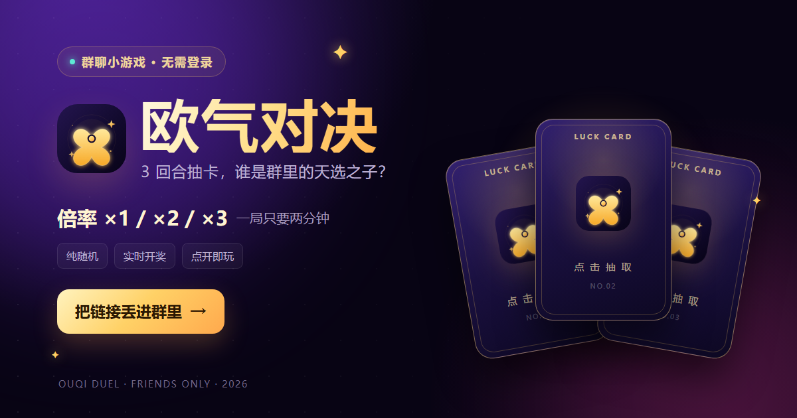
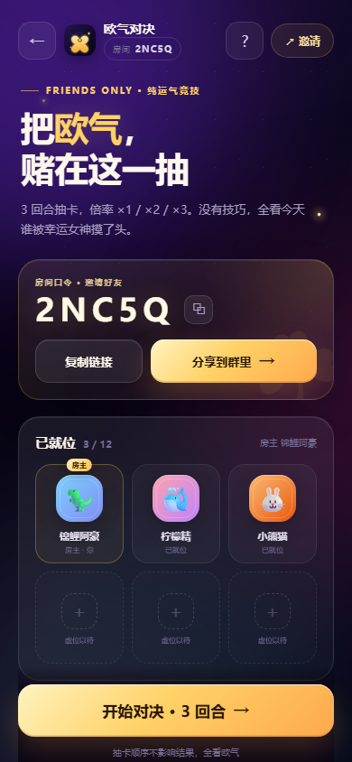
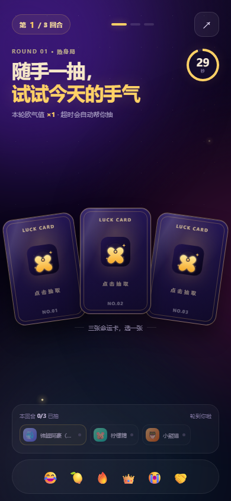
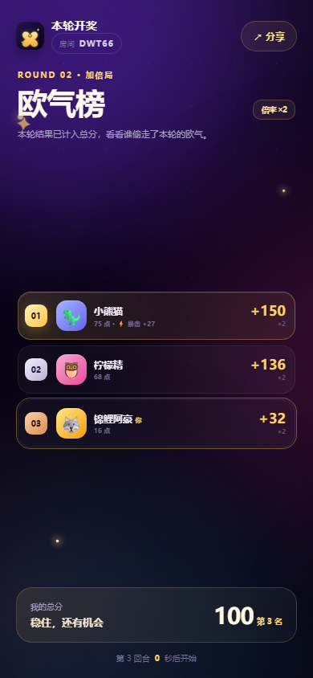
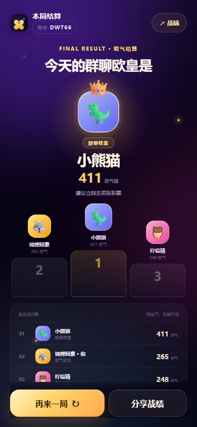

# 欧气对决

一个可以直接丢进群里的 3 回合运气对战小游戏。群友点开链接、填个昵称就能加入，同一间房里实时抽卡、开奖、看总榜。



| 房间大厅 | 选择命运卡 |
| --- | --- |
|  |  |

| 本轮开奖 | 最终结算 |
| --- | --- |
|  |  |

## 线上地址

**要发到 QQ / 微信群里，域名必须已备案。** 未备案域名（`*.app.workbuddy.host`、`*.onrender.com`、`*.vercel.app` 等）在 QQ 和微信的内置浏览器里会被直接拦截，弹「如需浏览，请使用浏览器访问」，请求根本到不了服务端——改页面代码、加 UA 判断、换短链都绕不过去。

- **国内群聊**：部署到腾讯云 CloudBase 云托管。默认域名 `*.tcloudbase.com` 挂在腾讯的备案主体下，QQ / 微信里能直接点开（首次会有一次「访问提示中间页」，绑自己的备案域名后消失）。步骤见 [DEPLOY.md](DEPLOY.md) 的「方式一」。
- **历史上线过的地址**：`https://ouqi-duel.app.workbuddy.host/?sharecode=<访问码>`，电脑浏览器能用，QQ / 微信里打不开。

托管平台给链接加的访问码参数 `?sharecode=` 会被页面记住，并自动拼进房间邀请链接（`/r/房间码?sharecode=...`）；在没有该参数的平台上这段逻辑不生效，不影响别的部署方式。

## 玩法

- 2–12 人一间房，每人每回合从 3 张命运卡中选 1 张。
- 每张卡随机开出 **1–140** 点欧气值，有 14% 概率触发「欧气暴击」。
- 第 1 / 2 / 3 回合分别按 **×1 / ×2 / ×3** 计入总分，最后一轮可以逆袭。
- 所有人抽完提前开奖；30 秒没抽会自动代抽。
- 三轮总分最高的人是「群聊欧皇」，最后一名获得「非酋保护协会」称号。
- 支持房间码、邀请链接、群内分享、表情互动和再来一局。

没有登录、没有技巧、没有充值，输了只能怪运气。

## 本地运行

需要 Node.js 20 或更高版本。

```bash
npm start
```

打开 `http://localhost:3000`。启动日志里会同时打印本机和局域网地址，同一个 Wi-Fi 下，手机直接打开局域网地址就能玩。电脑和手机需要处于同一网络，Windows 防火墙需要允许 Node.js 的入站连接。

开发时可以用：

```bash
npm run dev
```

> 注意：不要直接双击 `public/index.html`。它需要后端服务才能创建房间和联机，单独打开只是个空壳页面。

## 部署

`localhost` 和局域网地址只适合自己人测试。要发到 QQ / 微信群里，需要公网 HTTPS。

**推荐方案**：腾讯云 CloudBase 云托管——默认域名已备案，QQ / 微信里点开就能玩。用 Git 仓库部署时把「最小实例数」和「最大实例数」都设成 `1`：房间状态在进程内存里，缩容到 0 会清空对局，多实例会导致两个人落到不同进程、进不了同一个房间。

项目没有任何第三方依赖，根目录带好了 `Dockerfile`（云托管、Railway、VPS 都能用）和 `render.yaml`（Render 专用）。`PORT` / `HOST` 全部从环境变量读，没有写死的域名，`PORT` 由平台注入。

完整步骤、参数表、排错见 **[DEPLOY.md](DEPLOY.md)**。

> 免费实例会在无人访问时休眠，首次打开要等几十秒冷启动。

## 配置

| 环境变量 | 默认值 | 说明 |
| --- | --- | --- |
| `PORT` | `3000` | 监听端口 |
| `HOST` | `0.0.0.0` | 监听地址 |
| `ROUND_MS` | `30000` | 每回合抽卡时间（毫秒） |
| `REVEAL_MS` | `5200` | 每轮开奖展示时间（毫秒） |
| `TRUST_PROXY` | 空 | 设为 `1` 时总是信任 `X-Forwarded-For`（放在反向代理后面时用） |
| `QUIET` | 空 | 设为 `1` 时不打印启动日志，测试用 |

示例：

```bash
ROUND_MS=20000 REVEAL_MS=4000 npm start
```

房间最多 12 人，数据保存在 Node 进程内存里，房间闲置 6 小时后自动清理。服务重启会丢失所有进行中的房间，适合小型群聊局；如果要长期运营，建议把房间状态换成 Redis 并保持单实例或做房间分片。

## 测试

```bash
npm test
```

集成测试会在随机端口启动一个快速计时的服务，覆盖：创建/加入房间、权限校验、开奖前隐藏他人结果、三轮倍率计分、超时代抽、最终排名、再来一局等流程。

另有 `test/render.test.mjs` 用最小 DOM 环境加载前端脚本，校验大厅权限提示与代抽提醒的渲染分支。

## 拍演示视频

一个人录屏也能拍出多人对局：先开好房间，再让机器人进来陪你抽卡。

```bash
# 节奏紧凑一点：每回合 15 秒、开奖 4 秒
ROUND_MS=15000 REVEAL_MS=4000 npm start

# 另开一个终端，塞 4 个机器人进房间
node tools/demo-bots.mjs --room=房间码 --bots=4
```

机器人只负责抽卡，不会点开局，节奏由你控制。完整分镜、字幕文案、16:9 画中画排版参数见 **[VIDEO.md](VIDEO.md)**。

## 目录

```text
server.mjs              零依赖 Node HTTP 服务、房间状态机与 API
public/
  index.html            页面入口
  app.js                移动端交互、轮询、动效与分享
  styles.css            界面样式与动画
  icon.svg              品牌图标
  icon-192.png          应用图标
  icon-512.png          应用图标
  og.png                群聊分享预览图
  manifest.webmanifest  PWA 清单
test/game.test.mjs      联机流程集成测试
test/render.test.mjs    前端渲染回归测试
tools/demo-bots.mjs     演示机器人：给房间塞会自动抽卡的"路人"，方便录屏
Dockerfile              容器部署
render.yaml             Render 部署配置
DEPLOY.md               公网部署与排错指南
VIDEO.md                演示视频拍摄脚本与字幕说明
video-subtitles.srt     演示视频大字幕
```

## 实现说明

- 服务端用 `crypto.randomInt` 生成结果，抽卡结果在开奖前只返回给本人，避免通过接口提前看到别人分数。
- 客户端每秒轮询房间状态，服务端按时间戳懒推进回合，不依赖后台定时器，进程短暂卡顿也不会把游戏卡死。
- 玩家身份用浏览器 `localStorage` 里的房间 token 维持，刷新页面会自动回到原房间。
- 页面按手机竖屏设计，兼容 QQ / 微信内置浏览器；群链接直接打开即可，不需要下载。
- 分享图 `og.png` 是 1200×630 的群聊卡片。`index.html` 里的 `og:image` 是相对路径，服务端会按请求域名补成绝对地址，方便微信 / QQ 抓取。
- 限流按真实客户端 IP 计数：反向代理后面读 `X-Forwarded-For` / `CF-Connecting-IP`，直连时用 socket 地址，避免全群共用一个配额。
- 托管平台的访问码会自动透传：进站时记下 `?sharecode=`，`public/app.js` 的 `withShareCode()` 在生成邀请链接、切换房间地址时都带上它，群友点开不会被网关拦在门外。

## 想改成别的玩法

- 改回合数、倍率、暴击率：`server.mjs` 里的 `ROUND_COPY`、`generateResult`、`startGame`。
- 改文案和称号：`server.mjs` 的 `titleFor`，以及 `public/app.js` 的 `ROUND_THEMES`。
- 改主色和卡片样式：`public/styles.css` 顶部的 CSS 变量与 `.card` 区块。
- 想做成真正的 QQ 小程序：当前 H5 的房间 API 和状态机可以直接复用，前端需要改成小程序页面，并把 HTTP 轮询替换成 WebSocket 或云函数长连接。上线还需要 QQ 开放平台的 AppID 与审核。

## 说明

这是一个娱乐向的随机游戏，不涉及真实货币、抽奖售卖或概率变现。请只在朋友群里玩，别拿它赌博。
